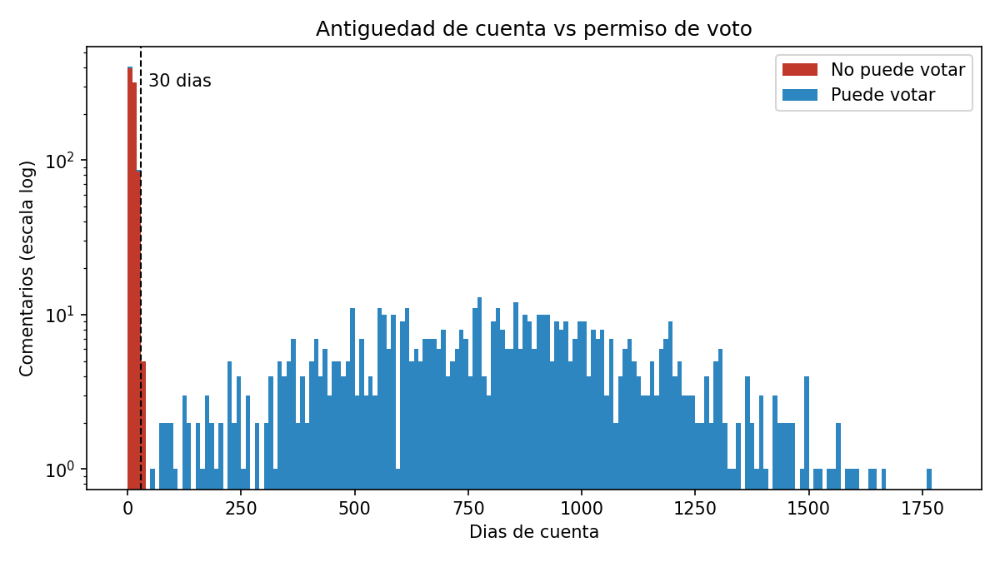
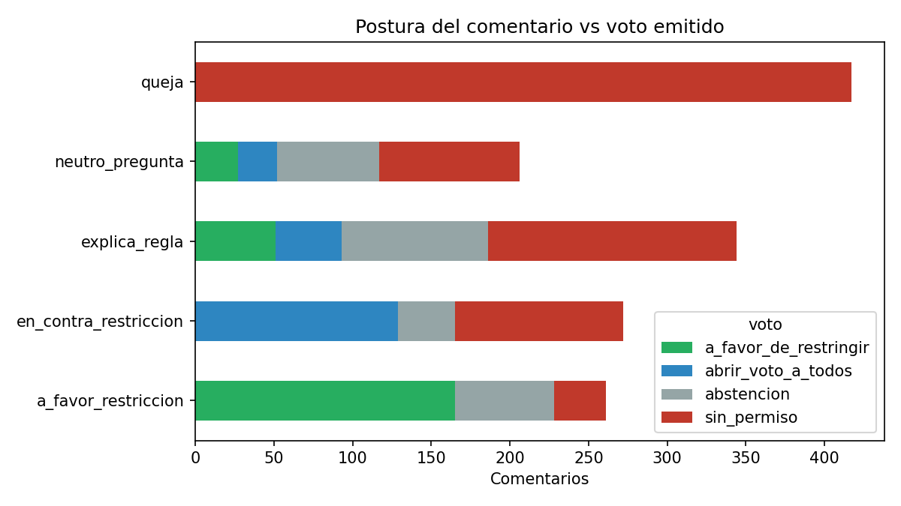
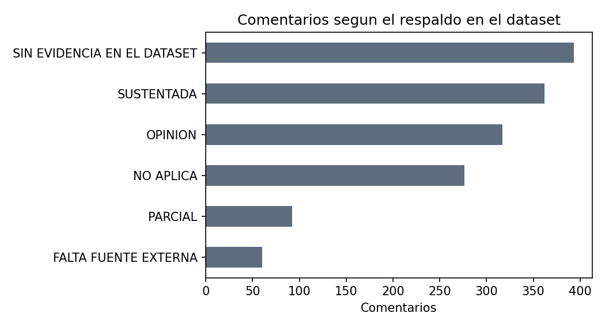

# Analisis del corpus: "no todos pueden votar"

**Objetivo:** revisar que tan bien sustenta el dataset lo que dicen los comentarios.
Cada comentario *afirma* algo ("necesitas 30 dias", "solo los verificados votan",
"hay bots"...). Aqui se compara cada afirmacion contra los datos reales de la cuenta
(`puede_votar`, `cuenta_verificada`, `dias_cuenta`, `voto`).

## Que significa cada columna
| Columna | Significado |
|---|---|
| `comentario` | Texto que escribio el usuario |
| `categoria` | Tipo de comentario: queja, explica_regla, a_favor_restriccion, en_contra_restriccion, neutro_pregunta |
| `sentimiento` | Positivo / neutro / negativo (equivale 1 a 1 a `categoria`) |
| `puede_votar` | 1 si la cuenta tiene permiso de voto, 0 si no |
| `cuenta_verificada` | 1 si la cuenta esta verificada |
| `dias_cuenta` | Antiguedad de la cuenta en dias |
| `voto` | Lo que voto: a_favor_de_restringir, abrir_voto_a_todos, abstencion o sin_permiso |

## 1. Calidad del corpus
*Que es:* revisar si el dataset es confiable antes de sacar conclusiones.

- Filas: **1500**, valores nulos: **0**.
- Textos distintos: **344**, pero al quitar signos, hashtags y muletillas ("pls", "??") quedan solo **44 afirmaciones unicas**. El corpus repite plantillas con pequenas variaciones.
- Filas duplicadas (mismo comentario y mismos datos, sin contar id ni usuario): **74**.
- `categoria` y `sentimiento` dicen lo mismo, asi que una de las dos sobra al modelar.

*Por que importa:* con tan poca variedad, un modelo solo memorizaria las frases.

## 2. Regla de dias de cuenta
*Que es:* comprobar si es cierto que hace falta una antiguedad minima para votar. El histograma muestra
cuantos comentarios hay por dias de cuenta, en rojo los que **no** pueden votar y en azul los que **si**
(la escala es logaritmica para que se vea el detalle).

- No pueden votar: **804** cuentas, con **1 a 32** dias (mediana 10).
- Si pueden votar: **696** cuentas, con mediana de **813** dias.
- Con un umbral de **30 dias** la regla se cumple en **99.0%** de las filas.
  Excepciones: **10** cuentas pueden votar con 30 dias o menos y **5** no pueden con mas de 30.

*Conclusion:* los comentarios que dicen "necesitas mas de 30 dias" o "las cuentas nuevas no pueden votar" **estan sustentados**.

## 3. Verificacion de cuenta
*Que es:* comprobar si "solo las cuentas verificadas pueden votar".

- Cuentas verificadas: **560**; de ellas pueden votar el **100%**. Verificadas que no pueden: **0**.
- Cuentas **no** verificadas que tambien pueden votar: **136**.

*Conclusion:* estar verificado **basta** para votar, pero **no es requisito**. La afirmacion es solo **parcialmente cierta**; pesa mas la antiguedad.

## 4. Coherencia entre postura y voto
*Que es:* ver si lo que la gente opina coincide con lo que vota. La grafica cuenta, por tipo de comentario, que voto emitieron.

- Comentarios a favor de restringir que votaron "abrir a todos": **0**.
- Comentarios en contra de restringir que votaron "a favor de restringir": **0**.
- Quejas hechas por cuentas sin permiso: **100%**.

*Conclusion:* las posturas son coherentes con el voto y todas las quejas vienen de cuentas realmente bloqueadas.
Los comentarios neutros (explica_regla, neutro_pregunta) se reparten entre todos los votos, como es de esperar.

## 5. Respaldo de cada afirmacion
*Que es:* se agruparon los comentarios en afirmaciones unicas y a cada una se le asigno un **veredicto** segun
si los datos la pueden comprobar. El detalle esta en `afirmaciones.csv`.

| Veredicto | Afirmaciones | Comentarios | Que significa |
|---|---|---|---|
| SIN EVIDENCIA EN EL DATASET | 11 | 393 | Habla de algo que el dataset no mide (bots, rol de alumno/staff...). |
| SUSTENTADA | 9 | 362 | Los datos la confirman (se cumple en casi todas las filas). |
| OPINION | 9 | 317 | Juicio de valor; los datos no lo pueden confirmar ni negar. |
| NO APLICA | 10 | 276 | Es una pregunta o una peticion, no afirma nada que se pueda comprobar. |
| PARCIAL | 3 | 92 | Los datos la confirman a medias: hay casos que la contradicen. |
| FALTA FUENTE EXTERNA | 2 | 60 | Es una norma institucional; hace falta el documento oficial en el corpus. |

**Nota:** la clasificacion usa reglas de palabras clave, asi que conviene revisar `afirmaciones.csv` por si alguna quedo mal puesta.

## Pendiente: fuentes externas para el corpus
- Reglamento o reglas oficiales (30 dias, verificacion, correo institucional, moderacion).
- Evidencia sobre bots y manipulacion de encuestas en foros.
- Columnas nuevas ideales: `es_bot`, `rol` (alumno/staff) y un registro de intentos de voto.
