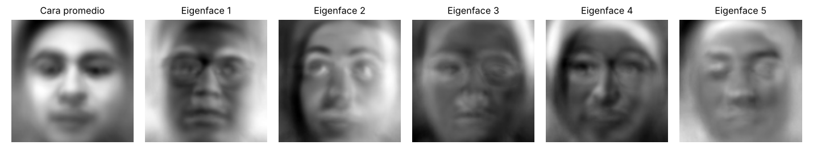
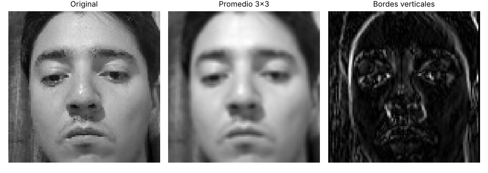

# Comparación: Eigenfaces, Fisherfaces y LBPH contra CNN

Los tres hacen lo mismo: se toma una foto de cara en grises de 100×100, se convierte en una lista de números y se compara con las caras que ya se conocen. `predict` devuelve la persona y una `confidence`, que es una **distancia** (mientras más baja, más parecida). Si queda debajo del umbral se muestra el nombre y, si no, "Desconocido".

Lo único que cambia es **cómo se convierte la cara en números**.

---

## Eigenfaces (PCA)

Una foto de 100×100 son 10 000 números, uno por píxel, y casi todos se repiten porque los píxeles vecinos se parecen. PCA encuentra las pocas direcciones en las que las caras más cambian entre sí. Vistas como imagen, son las _eigenfaces_.

**Con las fotos del proyecto.** Cada foto se aplana en una fila de 10 000 números. Estos son 4 píxeles del centro (fila 50, columnas 48 a 51) de tres fotos y su promedio:

| foto              | col 48 | col 49 | col 50 | col 51 |
| ----------------- | ------ | ------ | ------ | ------ |
| `pau_1747.jpg`    | 180    | 143    | 135    | 132    |
| `kike_1252.jpg`   | 126    | 125    | 125    | 125    |
| `cesare_1252.jpg` | 132    | 132    | 132    | 131    |
| **promedio**      | 146.0  | 133.3  | 130.7  | 129.3  |

A `pau_1747` le quedan `[34.0, 9.7, 4.3, 2.7]` al restar el promedio. Con las 2 800 fotos de entrenamiento (400 por persona, ya con el histograma igualado), la primera eigenface explica el 23.7 % de la variación, las primeras 5 el 52.1 %, las 80 que guarda el modelo el 87.2 %, y hacen falta 121 componentes para llegar al 90 %. O sea, 10 000 números se resumen en unos cientos.



Cada cara queda como una lista corta de números. Los primeros 5 de `pau_1747` son `[-3116, 756, -1032, -271, 530]` y los de `kike_1252`, `[1813, -1314, -1025, -1543, -5]`: quedan lejos, y así se distinguen.

**Bueno:** sencillo de entender y predice rápido (1.2 ms por foto). **Malo:** muy sensible a la luz y a la alineación, porque PCA busca lo que más varía, no lo que separa a una persona de otra. Y entrenarlo con OpenCV es lento.

---

## Fisherfaces (PCA + LDA)

Es Eigenfaces con un paso más. Después del PCA se aplica **LDA**, que sí sabe quién es quién: busca las direcciones que **separan a las personas** y **juntan las fotos de la misma persona**.

Con 7 personas, cada cara queda en solo **6 números** (personas − 1). Por eso el modelo pesa 2.4 MB y predice en 0.30 ms, pero entrenarlo tarda más (unos 25 min, contra unos 22 min de Eigenfaces con las mismas fotos).

**Bueno:** en teoría aguanta mejor la luz y las expresiones, y es el modelo más ligero y rápido para predecir. **Malo:** pide varias fotos por persona y es el más lento de entrenar.

---

## LBPH (patrones binarios locales)

No mira la cara completa, mira la **textura local**. Cada píxel se compara con sus 8 vecinos: si el vecino es mayor o igual, 1, y si no, 0. En `pau_1747.jpg`, el píxel de la fila 40, columna 32 (brillo 97) tiene estos vecinos:

```
138 121 121
109 [97] 94
 79  77  81
```

Horario desde arriba a la izquierda: 1, 1, 1, 0, 0, 0, 0, 1 → `11100001` = **225**. Luego se hace un histograma de estos códigos por celda de la cara (rejilla de 8×8 = 64 celdas, 256 valores por celda) y se juntan todos en un vector de 16 384 números, que se compara con el de las caras conocidas.

Aguanta la luz porque si toda la zona se aclara, las comparaciones no cambian y el código sigue siendo 225.

**Bueno:** entrena en unos 2 s y no necesita muchas fotos por persona. **Malo:** guarda un histograma por **cada foto de entrenamiento**, así que el modelo crece con el dataset (240 MB con 2 800 fotos; el `modelo_lbph.xml` que ya tenías, con más fotos, pesa unos 600 MB) y predecir es lo más lento, porque compara contra todos los histogramas guardados.

---

## Comparación con los datos del proyecto

Mismo split para los tres: **500 fotos por persona** repartidas a lo largo de todas las suyas, partidas por **bloques** como en `entrenar.py` (el primer 80 % de cada persona entrena, 400 por persona, 2 800 en total; el 20 % final prueba, 100 por persona, 700 en total), con las 7 personas. Preprocesado igual que en tus scripts: Eigenfaces y Fisherfaces con histograma igualado, LBPH sin igualar. Eigenfaces con 80 componentes, como en `entrenar_eigen.py`. Se reproduce con `python comparar_rostros.py`.

|                                      | LBPH            | Eigenfaces        | Fisherfaces       |
| ------------------------------------ | --------------- | ----------------- | ----------------- |
| Exactitud                            | **99.6 %** (697/700) | 96.3 % (674/700)  | 97.6 % (683/700)  |
| Entrenamiento                        | **2.1 s**       | 1 324 s (≈ 22 min) | 1 524 s (≈ 25 min) |
| Predicción por foto                  | 100.9 ms        | 1.20 ms           | **0.30 ms**       |
| Tamaño del modelo                    | 240 MB          | 25 MB             | **2.4 MB**        |
| `tony` (el más difícil)              | 100/100         | 75/100            | 91/100            |
| Umbral de ejemplo del curso          | 70              | 2800              | 500               |
| Distancia de los aciertos (mediana / percentil 95) | 63 / 82 | 2 475 / 4 327 | 56 / 126          |
| Distancia de los errores (mediana)   | 107             | 4 881             | 145               |

- **LBPH** ganó en exactitud y por mucho en tiempo de entrenamiento (2 s contra 22 y 25 min). Solo falló 3 fotos de 700.
- **Fisherfaces** fue el segundo en exactitud, el más lento de entrenar y el más ligero y rápido para predecir (0.30 ms y 2.4 MB).
- **Eigenfaces** quedó último en exactitud y el único problema grave fue `tony`: 24 de sus 25 errores fueron confundirlo con `pau`. En Fisherfaces `tony` también es el más difícil (9 errores, 5 de ellos hacia `pau`) y LBPH no lo falló.
- **Las distancias no se comparan entre métodos**, cada uno necesita su propio umbral. Con estos números, el 500 del curso para Fisherfaces casi no rechazaría a nadie (el percentil 95 de los aciertos es 126 y la mediana de los errores 145), así que conviene empezar cerca de 150. En Eigenfaces el 2800 del curso rechazaría casi la mitad de los aciertos (su mediana es 2 475) y el 4500 de `reconocer_eigen.py` queda cerca del percentil 95. En LBPH el 80 de `reconocer.py` también queda cerca del percentil 95 (82). Esto es un punto de partida: para calibrar de verdad hace falta probar con una persona que **no** esté en el dataset.

**Cómo leer estos resultados:**
- Los tiempos se midieron en un entorno en la nube con 2 núcleos de CPU y OpenCV 5.0.0, con Eigenfaces y Fisherfaces entrenando al mismo tiempo en núcleos distintos y LBPH solo. En tu computadora saldrán distintos, sobre todo los milisegundos por foto; lo que sí se mantiene es el orden (LBPH entrena más rápido pero predice más lento; Fisherfaces al revés).
- Eigenfaces con 80 componentes tardó casi lo mismo que los 21 min que le tomó a Cesar con todas las componentes, así que el tiempo parece venir del PCA y no de cuántas componentes se guarden. Por eso existe `entrenar_eigen_rapido.py`.
- Es una sola corrida por método y la prueba es optimista: las fotos de prueba salen de los mismos videos que las de entrenamiento (misma luz y cámara), aunque se partió por bloques para que no sean frames vecinos. En vivo con la cámara el resultado puede cambiar y eso **no se probó aquí**.
- Los resultados de Cesar (LBPH 95.0 %, Eigenfaces 93.4 %, Fisherfaces 90.7 %) son más bajos y ponen a Eigenfaces por encima de Fisherfaces, al revés que aquí. No se puede decir por qué: cambian las fotos elegidas, el split, el preprocesado y el número de componentes. Lo que coincide en ambos es que LBPH entrena en segundos y gana en exactitud, y que Fisherfaces es el más ligero y rápido para predecir. La diferencia entre Eigenfaces y Fisherfaces es chica (13 fotos de 700) y no hay que tomarla como definitiva.

---

## Contra CNN

Una CNN usa **convoluciones**: un **kernel** (cuadrícula chica de pesos) se desliza por la imagen, multiplica los píxeles por los pesos y suma. Cada kernel da un mapa de características, y al final unas capas deciden la clase.

**Con una foto del proyecto.** Un kernel de 3×3 con 1/9 en cada casilla es un **promedio**. Sobre un parche real de 4×4 de `pau_1747.jpg` (filas 38 a 41, columnas 30 a 33):

```
163 151 135 128
140 138 121 121
126 109  97  94
 81  79  77  81
```

El kernel cabe en 4 posiciones y la salida es de 2×2: `131.1, 121.6, 107.6, 101.9` (sumas de 1180, 1094, 968 y 917, entre 9). Aplicado a toda la foto desenfoca un poco, y un kernel de bordes deja solo los contornos:



En una CNN real los pesos **no se ponen a mano, se aprenden** con backpropagation.

|                       | Eigen / Fisher / LBPH                  | CNN                                         |
| --------------------- | -------------------------------------- | ------------------------------------------- |
| Características       | Fijas o estadísticas                   | **Las aprende de los datos**                |
| Datos                 | Cientos de fotos por persona           | Miles                                       |
| Entrenamiento         | Segundos a minutos en CPU (LBPH 2 s; Eigen y Fisher unos 22 y 25 min con OpenCV) | Horas, con **GPU**                          |
| Luz, pose y expresión | Frágiles (Eigen), medio (Fisher, LBPH) | Mucho más robusta                           |
| Persona nueva         | Reentrenar                             | Se compara con _embeddings_, sin reentrenar |
| Explicarlo            | Fácil, se calcula a mano               | "Caja negra"                                |

Eigenfaces y Fisherfaces aplanan la foto en una fila; una CNN conserva la forma 2D. Los estudios que comparan CNN contra LBPH encuentran que la CNN es más estable, pero LBPH entrena más rápido y es más ligera. En esta materia ya usaste una CNN en la actividad de deportes (`sportimages`), así que la idea de kernels, filtros y matriz de confusión es la misma.

**Para el proyecto:** con CPU y solo 7 personas, **LBPH es la opción práctica**: fue la más exacta en la prueba (99.6 %) y entrena en segundos. Si importa el tamaño del modelo o la velocidad de predicción (un dispositivo chico), Fisherfaces pesa 2.4 MB y predice en 0.30 ms, a costa de unos 25 min de entrenamiento. Una CNN sería el siguiente paso si hubiera más personas, más variación de luz y pose, y una GPU.
