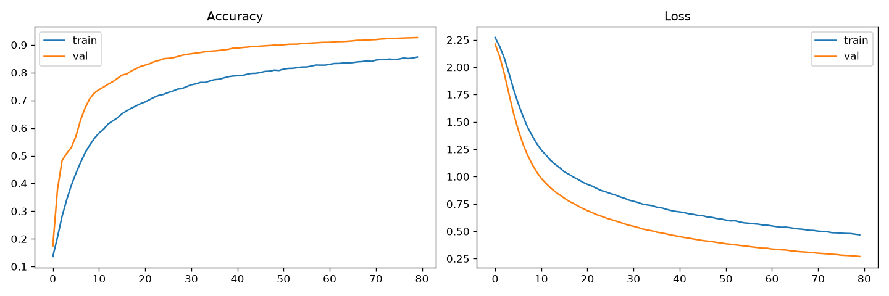
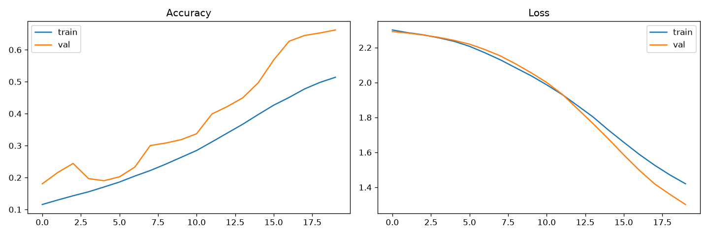
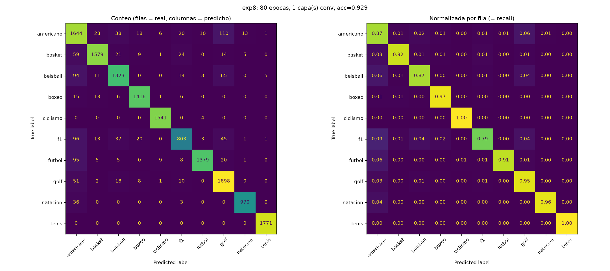

# Reporte: CNN para clasificación de imágenes deportivas

**Materia:** Inteligencia Artificial 
**Nombre:** Paulo César Pérez Martínez 
**Archivos:** `CNN_local.ipynb`, `run_cnn.py`, carpeta `resultados/` 
**Dataset:** `sportimages` (77,128 imágenes, 10 deportes)

---

## 1. Objetivo

Entrenar la red convolucional (CNN) del ejercicio sobre el dataset `sportimages`, variando el **número de épocas** y el **número de capas convolucionales**. Después se analiza la **matriz de confusión** de cada corrida y se compara con las métricas que explica el libro *Aprende Machine Learning* (capítulo "Datos desbalanceados", sección "Métricas y Confusion Matrix", pp. 77-80).

## 2. Dataset

Las imágenes son de 21×28 píxeles a color y están organizadas en una carpeta por deporte:

| Clase | Imágenes | % del total |
|---|---|---|
| americano | 9,348 | 12.1 % |
| basket | 8,823 | 11.4 % |
| beisball | 7,752 | 10.1 % |
| boxeo | 7,125 | 9.2 % |
| ciclismo | 7,533 | 9.8 % |
| f1 | 5,053 | 6.6 % |
| futbol | 7,617 | 9.9 % |
| golf | 9,768 | 12.7 % |
| natacion | 5,172 | 6.7 % |
| tenis | 8,937 | 11.6 % |
| **Total** | **77,128** | 100 % |

El dataset está **ligeramente desbalanceado**: la clase más grande (golf) tiene unas 1.9 veces las imágenes de la más pequeña (f1). Es un desbalance leve, muy lejos del caso extremo del libro (fraude con tarjetas: 492 casos de 284,807, es decir 0.17 %).

División de los datos (igual en todas las corridas, semilla 42): 80 % entrenamiento y 20 % prueba (15,426 imágenes); del entrenamiento se separó otro 20 % para validación.

## 3. Configuración de los experimentos

Se usó el script `run_cnn.py`. Con `--conv 1` y `--epochs 20` es la red del ejercicio original:

- Cada bloque convolucional: `Conv2D` (3×3, 32 × 2^i filtros) → `LeakyReLU(0.1)` → `MaxPooling 2×2` → `Dropout(0.5)`.
- Después: `Flatten` → `Dense(32)` → `LeakyReLU` → `Dropout(0.5)` → `Dense(10, softmax)`.
- Optimizador SGD con learning rate 0.001, batch de 64, pérdida `categorical_crossentropy`.

Se hicieron 8 corridas. Las épocas se variaron con 1 capa conv, y las capas conv se variaron con 20 épocas:

| Exp | Épocas | Capas conv | Parámetros | Accuracy test | Loss test | F1 macro | Tiempo |
|---|---|---|---|---|---|---|---|
| exp1 | 10 | 1 | 158,954 | 0.7262 | 1.0410 | 0.7040 | 18 s |
| exp3 | 20 | 1 | 158,954 | 0.8226 | 0.7037 | 0.8158 | 35 s |
| exp4 | 40 | 1 | 158,954 | 0.8880 | 0.4536 | 0.8859 | 69 s |
| exp7 | 60 | 1 | 158,954 | 0.9116 | 0.3398 | 0.9113 | 106 s |
| exp8 | 80 | 1 | 158,954 | 0.9286 | 0.2635 | 0.9291 | 530 s |
| exp5 | 20 | 2 | 105,770 | 0.7515 | 0.8755 | 0.7346 | 69 s |
| exp2 | 30 | 2 | 105,770 | 0.8093 | 0.6803 | 0.7955 | 103 s |
| exp6 | 20 | 3 | 142,762 | 0.6614 | 1.2993 | 0.6377 | 101 s |

*Los parámetros bajan con más capas porque cada `MaxPooling` reduce el mapa de características que entra al `Flatten` (con 1 capa entran 4,928 valores a la capa densa; con 3 capas, solo 1,536).*

## 4. Resultados

### 4.1 Efecto del número de épocas (1 capa conv)

| Épocas | Accuracy | Mejora respecto a la anterior |
|---|---|---|
| 10 | 72.6 % | — |
| 20 | 82.3 % | +9.6 puntos |
| 40 | 88.8 % | +6.5 puntos |
| 60 | 91.2 % | +2.4 puntos |
| 80 | **92.9 %** | +1.7 puntos |

- La mejora es grande al inicio y se va reduciendo: entre 60 y 80 épocas se gana menos de 2 puntos, aunque el entrenamiento cuesta mucho más tiempo.
- El loss de prueba baja de 1.04 a 0.26.
- **No hay sobreajuste** en la corrida de 80 épocas. En `resultados/exp8/curvas.png` la curva de validación queda *por encima* de la de entrenamiento, y ambas siguen mejorando al final. Esto es normal con `Dropout(0.5)`, porque Keras mide el entrenamiento con el dropout activo y la validación sin él. Significa que el modelo **aún no había terminado de aprender** y que más épocas probablemente seguirían mejorando el resultado.
- El tiempo de `exp8` (530 s) no sigue la tendencia de las demás corridas (60 épocas tardaron 106 s). No puedo asegurar la causa; lo más probable es carga de la computadora durante esa corrida.

### 4.2 Efecto del número de capas convolucionales (20 épocas)

| Capas conv | Accuracy | F1 macro |
|---|---|---|
| 1 | **82.3 %** | 0.816 |
| 2 | 75.2 % | 0.735 |
| 3 | 66.1 % | 0.638 |

Con las mismas 20 épocas, **más capas dieron peor resultado**. Con 30 épocas, la red de 2 capas (`exp2`) alcanzó 80.9 %, todavía por debajo de la red de 1 capa con solo 20 épocas.

Esto **no demuestra que más capas sean peores**. La curva de `exp6` (3 capas) en `resultados/exp6/curvas.png` muestra que el modelo apenas estaba empezando a mejorar al terminar la época 20: la precisión sube casi en línea recta y el loss sigue bajando (de 2.3 a 1.3). Las redes más profundas aprenden más lento con SGD y learning rate 0.001, así que 20 épocas las dejan **subentrenadas**. Para saber si una red más profunda supera a la de 1 capa habría que entrenarla muchas más épocas, como se hizo con la de 1 capa.

## 5. Análisis de la matriz de confusión

### 5.1 Cómo leerla

La matriz tiene los valores **reales en las filas** y los **predichos en las columnas**, igual que la figura de la p. 78 del libro. La diagonal son los aciertos (verdaderos positivos). Para una clase:

- **Precisión** = aciertos de la clase ÷ todo lo que se predijo como esa clase (suma de su *columna*).
- **Recall** = aciertos de la clase ÷ todas las imágenes reales de esa clase (suma de su *fila*).
- **F1** = media armónica de precisión y recall.

Ejemplo con la mejor corrida (`exp8`), clase golf: acierta 1,898 imágenes; la columna golf suma 2,152 predicciones, así que precisión = 1,898 / 2,152 = **0.882**; la fila golf suma 1,988 imágenes reales, así que recall = 1,898 / 1,988 = **0.955**. Coincide con el reporte de `sklearn`.

### 5.2 Mejor modelo (`exp8`: 80 épocas, 1 capa conv, accuracy 92.9 %)

| real \ predicho | americano | basket | beisball | boxeo | ciclismo | f1 | futbol | golf | natacion | tenis |
|---|---|---|---|---|---|---|---|---|---|---|
| **americano** | **1644** | 28 | 38 | 18 | 6 | 20 | 10 | 110 | 13 | 1 |
| **basket** | 59 | **1579** | 21 | 9 | 1 | 24 | 0 | 14 | 5 | 0 |
| **beisball** | 94 | 11 | **1323** | 0 | 0 | 14 | 3 | 65 | 0 | 5 |
| **boxeo** | 15 | 13 | 6 | **1416** | 1 | 6 | 0 | 0 | 0 | 0 |
| **ciclismo** | 0 | 0 | 0 | 0 | **1541** | 0 | 4 | 0 | 0 | 0 |
| **f1** | 96 | 13 | 37 | 20 | 0 | **803** | 3 | 45 | 1 | 1 |
| **futbol** | 95 | 5 | 5 | 0 | 9 | 8 | **1379** | 20 | 1 | 0 |
| **golf** | 51 | 2 | 18 | 8 | 1 | 10 | 0 | **1898** | 0 | 0 |
| **natacion** | 36 | 0 | 0 | 0 | 0 | 3 | 0 | 0 | **970** | 0 |
| **tenis** | 0 | 0 | 0 | 0 | 0 | 0 | 0 | 0 | 0 | **1771** |

| Clase | Precisión | Recall | F1 | Muestras (test) |
|---|---|---|---|---|
| americano | 0.787 | 0.871 | 0.827 | 1888 |
| basket | 0.956 | 0.922 | 0.939 | 1712 |
| beisball | 0.914 | 0.873 | 0.893 | 1515 |
| boxeo | 0.963 | 0.972 | 0.967 | 1457 |
| ciclismo | 0.988 | 0.997 | 0.993 | 1545 |
| f1 | 0.904 | 0.788 | 0.842 | 1019 |
| futbol | 0.986 | 0.906 | 0.944 | 1522 |
| golf | 0.882 | 0.955 | 0.917 | 1988 |
| natacion | 0.980 | 0.961 | 0.970 | 1009 |
| tenis | 0.996 | 1.000 | 0.998 | 1771 |

- **Mejor reconocidos:** tenis (F1 0.998), ciclismo (0.993), natación (0.970) y boxeo (0.967). Tenis no falla en ninguna de sus 1,771 imágenes de prueba.
- **Más difíciles:** americano (F1 0.827) y f1 (0.842).
- **Confusiones más frecuentes** (real → predicho): americano → golf (110), f1 → americano (96), futbol → americano (95) y beisball → americano (94).
- La clase *americano* funciona como "comodín": recibe muchas imágenes de otros deportes (precisión 0.787), aunque detecta bien las suyas (recall 0.871).

### 5.3 Modelo con pocas épocas (`exp1`: 10 épocas, 1 capa conv, accuracy 72.6 %)

| real \ predicho | americano | basket | beisball | boxeo | ciclismo | f1 | futbol | golf | natacion | tenis |
|---|---|---|---|---|---|---|---|---|---|---|
| **americano** | **636** | 100 | 79 | 93 | 23 | 15 | 85 | 776 | 20 | 61 |
| **basket** | 72 | **1199** | 37 | 305 | 3 | 5 | 0 | 68 | 15 | 8 |
| **beisball** | 42 | 82 | **945** | 24 | 0 | 1 | 6 | 397 | 0 | 18 |
| **boxeo** | 12 | 59 | 24 | **1332** | 2 | 0 | 9 | 0 | 0 | 19 |
| **ciclismo** | 0 | 0 | 0 | 8 | **1524** | 0 | 13 | 0 | 0 | 0 |
| **f1** | 198 | 86 | 90 | 108 | 12 | **153** | 52 | 276 | 11 | 33 |
| **futbol** | 24 | 16 | 29 | 6 | 84 | 9 | **947** | 357 | 40 | 10 |
| **golf** | 66 | 61 | 25 | 19 | 1 | 0 | 16 | **1777** | 14 | 9 |
| **natacion** | 32 | 0 | 1 | 39 | 0 | 0 | 0 | 12 | **919** | 6 |
| **tenis** | 0 | 0 | 0 | 0 | 0 | 0 | 0 | 0 | 0 | **1771** |

| Clase | Precisión | Recall | F1 | Muestras (test) |
|---|---|---|---|---|
| americano | 0.588 | 0.337 | 0.428 | 1888 |
| basket | 0.748 | 0.700 | 0.723 | 1712 |
| beisball | 0.768 | 0.624 | 0.689 | 1515 |
| boxeo | 0.689 | 0.914 | 0.786 | 1457 |
| ciclismo | 0.924 | 0.986 | 0.954 | 1545 |
| f1 | 0.836 | 0.150 | 0.255 | 1019 |
| futbol | 0.840 | 0.622 | 0.715 | 1522 |
| golf | 0.485 | 0.894 | 0.629 | 1988 |
| natacion | 0.902 | 0.911 | 0.906 | 1009 |
| tenis | 0.915 | 1.000 | 0.956 | 1771 |

- Golf es la clase "comodín": el modelo predijo golf **3,663 veces**, cuando solo hay 1,988 imágenes reales. De las 1,888 imágenes de americano, **776 (41 %)** se clasificaron como golf.
- La clase f1 casi no se detecta: de 1,019 imágenes reales, solo 153 se reconocieron (recall 0.150), y el modelo solo predijo f1 en 183 ocasiones.
- Con más entrenamiento estos errores bajan mucho (americano → golf pasa de 776 a 110), pero **las mismas clases siguen siendo las más débiles** (americano, f1, golf, beisball).

*Una posible explicación, que no verifiqué, es que al reducir las imágenes a 21×28 píxeles los fondos verdes del campo (pasto de fútbol americano, golf, beisbol) se parecen mucho entre sí. Habría que revisar las imágenes mal clasificadas para confirmarlo.*

### 5.4 F1 por clase en todas las corridas

| Clase | exp1 (10ep, 1c) | exp3 (20ep, 1c) | exp4 (40ep, 1c) | exp7 (60ep, 1c) | exp8 (80ep, 1c) | exp5 (20ep, 2c) | exp2 (30ep, 2c) | exp6 (20ep, 3c) |
|---|---|---|---|---|---|---|---|---|
| americano | 0.428 | 0.631 | 0.755 | 0.796 | 0.827 | 0.488 | 0.623 | 0.387 |
| basket | 0.723 | 0.846 | 0.907 | 0.931 | 0.939 | 0.778 | 0.820 | 0.623 |
| beisball | 0.689 | 0.773 | 0.828 | 0.862 | 0.893 | 0.692 | 0.734 | 0.528 |
| boxeo | 0.786 | 0.892 | 0.935 | 0.957 | 0.967 | 0.878 | 0.900 | 0.867 |
| ciclismo | 0.954 | 0.973 | 0.986 | 0.993 | 0.993 | 0.967 | 0.979 | 0.952 |
| f1 | 0.255 | 0.556 | 0.738 | 0.807 | 0.842 | 0.293 | 0.400 | 0.000 |
| futbol | 0.715 | 0.812 | 0.896 | 0.918 | 0.944 | 0.753 | 0.843 | 0.746 |
| golf | 0.629 | 0.764 | 0.872 | 0.897 | 0.917 | 0.662 | 0.772 | 0.588 |
| natacion | 0.906 | 0.923 | 0.945 | 0.955 | 0.970 | 0.903 | 0.915 | 0.829 |
| tenis | 0.956 | 0.989 | 0.997 | 0.998 | 0.998 | 0.932 | 0.969 | 0.857 |

- Tenis, ciclismo y boxeo son fáciles en todas las corridas, incluso con pocas épocas.
- **f1** es la clase más inestable. En `exp6` su F1 es **0.000**: el modelo no predijo f1 ni una sola vez (su columna en la matriz es de ceros).

## 6. Comparación con el libro (*Aprende Machine Learning*, p. 80)

La p. 80 describe los **cuatro casos posibles** de precisión y recall para cada clase. El libro llega a ellos desde la matriz de confusión de las pp. 77-79: su ejemplo de 990 gatos y 10 perros, donde el modelo siempre contesta "gato", da 99 % de accuracy pero 0 de recall y de F1 para perros. Los cuatro casos aparecen en nuestros resultados:

| Caso del libro | Significado según el libro | Ejemplo en nuestros resultados |
|---|---|---|
| **Alta precisión y alto recall** | El modelo maneja perfectamente esa clase | tenis en `exp8`: 0.996 / 1.000; ciclismo: 0.988 / 0.997 |
| **Alta precisión y bajo recall** | No detecta bien la clase, pero cuando lo hace es confiable | f1 en `exp1`: precisión 0.836, recall 0.150 (`exp5`: 0.877 / 0.176) |
| **Baja precisión y alto recall** | Detecta bien la clase, pero también incluye muestras de otras | golf en `exp1`: precisión 0.485, recall 0.894 |
| **Baja precisión y bajo recall** | El modelo no logra clasificar la clase correctamente | americano en `exp6`: 0.328 / 0.472; f1 en `exp6`: 0 / 0 |

Otros puntos de comparación:

1. **El caso extremo del libro.** En `exp6`, f1 tiene una columna de ceros en la matriz, igual que la columna "Perro" del ejemplo del libro. Con ninguna predicción de f1, la precisión queda en 0 (en realidad es 0/0, que `sklearn` reporta como 0) y el F1 también. Aquí el accuracy global (66.1 %) no esconde el problema tanto como en el ejemplo del libro, pero la tabla por clase sí lo muestra.
2. **La advertencia sobre el accuracy.** El libro dice que medir solo por aciertos da "una falsa sensación de que el modelo funciona bien". En nuestro caso accuracy y F1 macro son parecidos (por ejemplo 0.929 y 0.929), porque el desbalance es leve. Aun así, solo la matriz y el reporte por clase muestran que f1 y americano son las clases débiles, algo que el 92.9 % no deja ver.
3. **Clase minoritaria.** El libro dice que con desbalance suele haber *alta precisión en la mayoritaria y bajo recall en la minoritaria*. Se cumple a medias: f1, la clase más pequeña (6.6 %), sí tiene el recall más bajo de las 8 corridas. Pero natación, también minoritaria (6.7 %), tiene recall alto (0.961 en `exp8`), y golf, la más grande, tuvo **baja** precisión en las primeras corridas. Es decir, el desbalance de este dataset (1.9 a 1) no explica por sí solo los errores. Parte del problema parece venir de qué tan parecidas son visualmente las clases.

El libro propone para casos de desbalance (p. 83) ajustar el peso de las clases, modificar el dataset o crear muestras sintéticas. No las probé; sería el siguiente paso si se quisiera mejorar f1.

## 7. Conclusiones

1. **Más épocas mejoran el modelo, con rendimientos decrecientes.** Con 1 capa conv el accuracy sube de 72.6 % (10 épocas) a 92.9 % (80 épocas). Entre 60 y 80 épocas la ganancia es de solo 1.7 puntos.
2. **El modelo no sobreajusta y aún puede mejorar.** La validación está por encima del entrenamiento y las curvas siguen bajando al final de las 80 épocas.
3. **Con 20 épocas, más capas conv dieron peores resultados** (82.3 %, 75.2 % y 66.1 % con 1, 2 y 3 capas). La causa más probable es subentrenamiento (las curvas lo sugieren), no que la arquitectura profunda sea peor.
4. **El accuracy no cuenta toda la historia.** La matriz de confusión muestra que americano, f1, golf y beisball son las clases que más se confunden, y que el patrón se mantiene en todas las corridas.
5. **Las métricas del libro explican bien los errores.** Los cuatro casos de precisión y recall de la p. 80 aparecen en nuestras corridas: golf (baja precisión, alto recall) y f1 (alta precisión, bajo recall) en `exp1`, y f1 con 0 / 0 en `exp6`.

## 8. Limitaciones

- Se corrió **una sola vez** cada configuración. No se midió cuánto varían los resultados con otra inicialización, por lo que las diferencias pequeñas deben tomarse con cuidado.
- Las redes de 2 y 3 capas se probaron solo con 20 y 30 épocas, así que la comparación de capas no es concluyente.
- Las imágenes son muy pequeñas (21×28), lo que limita lo que cualquier red puede distinguir.
- Las explicaciones de por qué se confunden ciertos deportes son hipótesis; no se revisaron las imágenes mal clasificadas.

## 9. Trabajo futuro

- Entrenar las redes de 2 y 3 capas con 60-80 épocas para comparar de forma justa con la de 1 capa.
- Probar un `Dropout` menor en los bloques convolucionales y un learning rate mayor.
- Aplicar `class_weight` (estrategia 1 del libro, p. 83) para mejorar el recall de f1.
- Revisar visualmente las imágenes de americano, f1 y golf que se clasifican mal.

## Referencias

- Bagnato, J. I. *Aprende Machine Learning*. Capítulo "Datos desbalanceados", pp. 77-83.
- Resultados completos en la carpeta `resultados/` (matrices en `.csv` y `.png`, curvas, reportes y `resumen.csv`).
